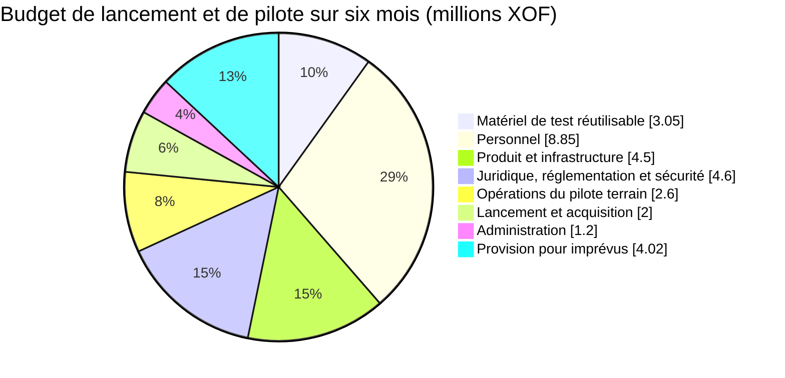

# Fidelia — Finances : budget du pilote, prévisions et preuves

*Document de travail · octobre 2026 · Côte d'Ivoire · XOF · [English version](FINANCE.md)*

Ce document est le **seul modèle financier** de Fidelia. Les chiffres du [dossier investisseur](INVESTOR-BRIEF.fr.md) en sont tirés ; quand un chiffre change ici, le changer aussi là-bas (ainsi que dans sa version anglaise et les pages web qu'il cite).

Les équivalents en euros sont calculés au taux fixe de **1 € = 655,957 XOF** et arrondis à deux décimales. Le XOF reste la devise de référence pour l'exploitation et les contrats ; les montants en euros sont fournis à titre comparatif. **Chaque montant est une estimation de gestion ou une hypothèse à tester, pas un devis fournisseur ni un résultat observé.**

## 1. Synthèse

| | Montant |
|---|---:|
| Enveloppe de lancement et de pilote sur six mois (coûts directs + 15 % d'imprévus) | **XOF 30 820 000 (€46 984,79)** |
| Tour pilote de pré-amorçage qui la finance, en deux tranches (§ 4) | **XOF 31 M (€47 260)** |
| Besoin de financement total jusqu'à la fin de l'année 3 (§ 3) | **environ XOF 148 M**, en deux tours |
| Commerçants payants nécessaires pour couvrir les coûts fixes | 334 (année 1) · 625 (année 2) · **1 250 (année 3, atteints au T11)** |

Le tour pilote finance uniquement les six premiers mois, y compris les appareils de test réutilisables. Le report des deux indemnités des fondateurs réduirait les coûts directs de **XOF 6,0 M (€9 146,94)** et ramènerait l'enveloppe à environ **XOF 23,92 M (€36 465,80)** après recalcul de la provision. Il s'agit d'une rémunération différée, et non d'un modèle d'exploitation sans coût.

## 2. Budget du pilote sur six mois

### Périmètre et hypothèses

- Six mois : environ deux mois de découverte, conformité, mise en place des partenariats et préparation à la production (phase 0), puis quatre mois d'opérations sur le terrain (phase 1), assez pour observer au moins 60 jours d'utilisation réelle. Un corridor d'Abidjan, sans expansion.
- Cinq à dix maquis et épiceries (les pharmacies sont hors du pilote, voir [CONCEPT.md § 12](CONCEPT.md#12-pilot-boundaries)). **Le pilote est gratuit pour tous les commerçants** ; à la fin, la formule payante est proposée à chacun.
- Seuls les appareils de test de l'entreprise, aucun équipement pour les commerçants : deux téléphones Android, deux iPhone, deux tablettes Android, deux iPad et deux ordinateurs portables de milieu de gamme ou reconditionnés. Les prix sont des provisions et non des devis ; les réduire si des appareils adaptés sont déjà disponibles.
- La préparation à la production comprend la connexion de niveau 0 par téléphone/OTP, les contrôles d'accès, les secrets et sauvegardes de production, une intégration avec un partenaire de paiement en production et la capture Wave si l'accès est approuvé.
- Fidelia ne détient pas de fonds, n'accorde pas de prêts, ne souscrit pas de crédit et ne finance pas les récompenses des commerçants. Les paiements des clients continuent d'arriver sur le portefeuille existant du commerçant ; le recours à un agrégateur n'est pas l'hypothèse par défaut.
- Les coûts sont présentés TTC en XOF. Le traitement fiscal, la récupération éventuelle de la TVA, le statut de la société et les frais minimaux ou d'intégration des partenaires restent à confirmer.

### Budget détaillé

| Poste | Base de calcul | XOF | Équivalent en euros |
|---|---|---:|---:|
| **Matériel de test réutilisable** |  | **3 050 000** | **4 649,70** |
| Téléphones Android | 2 × 125 000 | 250 000 | 381,12 |
| Téléphones iOS (iPhone) | 2 × 300 000 | 600 000 | 914,69 |
| Tablettes Android | 2 × 150 000 | 300 000 | 457,35 |
| Tablettes iOS (iPad) | 2 × 300 000 | 600 000 | 914,69 |
| Ordinateurs portables | 2 × 500 000 ; estimation milieu de gamme/reconditionné | 1 000 000 | 1 524,49 |
| Coques, chargeurs, adaptateurs et protections d'écran | Provision pour le parc | 300 000 | 457,35 |
| **Personnel** |  | **8 850 000** | **13 491,74** |
| Indemnité du fondateur technique | 6 mois × 600 000 | 3 600 000 | 5 488,16 |
| Indemnité du fondateur commercial/partenariats | 6 mois × 400 000 | 2 400 000 | 3 658,78 |
| Coordonnateur du pilote / agent terrain | 6 mois × 350 000 | 2 100 000 | 3 201,43 |
| Support client et contrôle qualité des données à temps partiel | 3 mois × 250 000 | 750 000 | 1 143,37 |
| **Produit et infrastructure** |  | **4 500 000** | **6 860,21** |
| Intégration spécialisée et préparation à la production | 24 jours × 100 000 ; OTP, Wave/webhooks, contrôles d'accès et préparation des versions | 2 400 000 | 3 658,78 |
| Hébergement, base de données, domaine, sauvegardes et supervision | 6 mois × 150 000 | 900 000 | 1 372,04 |
| Tests OTP, SMS/WhatsApp et paiements | Provision pour le volume du pilote ; tarifs fournisseurs à confirmer | 600 000 | 914,69 |
| Connectivité des commerçants | 10 points de vente × 10 000 × 6 mois ; aucun téléphone acheté pour les commerçants | 600 000 | 914,69 |
| **Juridique, réglementation et sécurité** |  | **4 600 000** | **7 012,65** |
| Immatriculation de la société et formalités juridiques/de marque | Provision ponctuelle ; à supprimer ou réduire si déjà réglée | 800 000 | 1 219,59 |
| Conseil réglementaire, protection des données et contrats | Flux financiers, données/consentement, conditions et contrat partenaire | 1 800 000 | 2 744,08 |
| Évaluation de sécurité indépendante et ciblée | Revue de préparation à la production et provision pour contre-test | 1 500 000 | 2 286,74 |
| Appui au contrat et à l'intégration du partenaire de paiement | Hors frais minimaux partenaires non chiffrés | 500 000 | 762,25 |
| **Opérations du pilote terrain** |  | **2 600 000** | **3 963,67** |
| Transport dans le corridor et indemnités terrain | 6 mois × 250 000 | 1 500 000 | 2 286,74 |
| Intégration et formation des commerçants | 10 points de vente × 50 000 | 500 000 | 762,25 |
| QR imprimés et matériel marchand | Kit ponctuel pour le corridor | 250 000 | 381,12 |
| Rencontres avec les associations et sessions terrain | Provision | 350 000 | 533,57 |
| **Lancement et acquisition** |  | **2 000 000** | **3 048,98** |
| Contenus de lancement en français/langues locales et création | Provision ; priorité aux supports destinés aux commerçants | 500 000 | 762,25 |
| Lancement dans le corridor et activation des clients | Actions locales ciblées ; pas de campagne média payante à grande échelle | 800 000 | 1 219,59 |
| Commissions de recommandation/revendeurs | Provision plafonnée ; paiement uniquement pour les commerçants acquis éligibles | 300 000 | 457,35 |
| Démonstrations et prospection partenaires | Provision | 400 000 | 609,80 |
| **Administration** |  | **1 200 000** | **1 829,39** |
| Comptabilité et tenue des livres | 6 mois × 100 000 | 600 000 | 914,69 |
| Communications professionnelles, banque et frais administratifs | Provision | 300 000 | 457,35 |
| Logiciels et outils de productivité essentiels | Provision | 300 000 | 457,35 |
| **Sous-total des coûts directs** |  | **26 800 000** | **40 856,34** |
| Provision pour imprévus | 15 % des coûts directs | 4 020 000 | 6 128,45 |
| **Total** |  | **30 820 000** | **46 984,79** |

### Éléments non compris

- Une deuxième intégration opérateur, le raccordement PI-SPI ou des travaux au-delà du MVP avec un seul partenaire.
- Les campagnes à grande échelle de la phase 2, les ventes multi-sites, les tontines, le scoring, l'épargne, le crédit ou les commissions de partenaires financiers.
- Le principal des prêts, les fonds des clients, le volume des paiements marchands ou les récompenses financées par les commerçants.
- Le matériel au-delà du parc de test réutilisable (téléphones des commerçants, terminaux de paiement) ; le concept et l'étude de marché déconseillent un déploiement fortement dépendant du matériel.
- Les salaires au taux du marché, les rémunérations différées des fondateurs, l'expansion géographique ou plus de six mois de trésorerie.
- Les frais d'intégration/minimums partenaires non chiffrés, la réponse à un incident majeur, les litiges ou les impôts non couverts par les provisions.

Tout frais matériel du prestataire de paiement doit être communiqué avant le paiement du client et ne doit pas rendre le paiement plus coûteux pour le commerçant que son portefeuille actuel.

### Recettes du pilote

**Nulles par choix** : abonnement et bons plans sont gratuits pendant le pilote, et le besoin de financement correspond aux dépenses brutes. À titre indicatif, si les 5 à 10 commerçants du pilote acceptaient la formule payante, les quatre premiers mois après le pilote rapporteraient **XOF 100 000 (€152,45) à XOF 600 000 (€914,69) bruts**. Il s'agit d'une illustration, pas d'une prévision.

## 3. Prévisions sur trois ans

Avec 1 800 commerçants payants à la fin de l'année 3, Fidelia encaisse environ **14 millions de FCFA par mois** et couvre ses coûts fixes ; il lui faut environ **148 millions de FCFA au total** pour y arriver, en deux tours. Chaque chiffre est une hypothèse à remplacer par les résultats du pilote.

Commerçants payants à chaque fin de trimestre, depuis le début du pilote : T1 0 · T2 4 · T3 40 · T4 100 · T5 180 · T6 280 · T7 420 · T8 600 · T9 800 · T10 1 050 · T11 1 400 · T12 1 800. Les coûts fixes sont couverts à partir de 334 commerçants payants en année 1 (après le pilote), 625 en année 2 et **1 250 en année 3, atteints au T11**. Les pertes augmentent encore en année 3, parce que les dépenses d'acquisition augmentent avec le nombre de commerçants.

| M FCFA | Année 1 | Année 2 | Année 3 |
|---|---:|---:|---:|
| Commerçants payants en fin d'année | 100 | 600 | 1 800 |
| Revenus | 2,1 | 29,2 | 105,5 |
| Coûts fixes (l'année 1 inclut le pilote de 30,8) | 42,8 | 48,0 | 96,0 |
| Acquisition | 4,0 | 20,0 | 48,0 |
| Coûts variables | 0,4 | 5,5 | 20,0 |
| **Résultat net** | **−45,1** | **−44,4** | **−58,6** |
| Besoin de financement cumulé | 45,1 | 89,5 | 148,1 |

| Hypothèse | Valeur | Fondement |
|---|---|---|
| Abonnement | 7 500 F / mois / point de vente, moyenne | Milieu des formules à 5 000 F et 10 000–15 000 F ([BUSINESS-MODEL.md](BUSINESS-MODEL.md#pricing-experiment)) |
| Bons plans sponsorisés, dès l'année 2 | 10 % des commerçants achètent 2 emplacements par mois à 2 000 F (+400 F par commerçant) | Prix d'emplacement testés entre 1 000 et 3 000 F pour 7 jours ([BUSINESS-MODEL.md](BUSINESS-MODEL.md)) |
| Conversion du pilote | 4 commerçants du pilote sur 10 paient au mois 6 | Le seuil de sortie du pilote, ≥ 40 % |
| Croissance | 100, 600 et 1 800 commerçants payants en fin d'année, départs déduits | Une commune, puis d'autres communes d'Abidjan ; à recalculer à partir du rythme d'acquisition réel du pilote |
| Coût d'acquisition | 40 000 F par nouveau commerçant payant | Agents de terrain et commissions de revendeurs ; le pilote budgète 50 000 F par intégration |
| Coût variable | 1 500 F / mois / commerçant (marge de 80 % à 7 500 F) | Hébergement, codes SMS, support |
| Coûts fixes | Pilote 30,8 M, puis 2 M / mois (année 1), 4 M (année 2), 8 M (année 3) | § 2, puis une équipe terrain et un support qui grandissent avec les commerçants |
| Commissions partenaires | 0 | Non supposées tant qu'aucun accord partenaire n'existe |

Les XOF 2,0 M/mois de l'année 1 après le pilote comprennent les indemnités des fondateurs (XOF 1,0 M), le terrain et le support client (XOF 500 000), l'hébergement et les sauvegardes fixes (XOF 150 000), les ventes et déplacements (XOF 200 000), ainsi que la comptabilité, l'administration et les logiciels (XOF 150 000).

Formule du seuil : coûts fixes mensuels ÷ (revenu par commerçant − coût variable par commerçant), arrondi à l'entier supérieur. Année 1 : 2 000 000 ÷ 6 000 = 334. Les années 2 et 3 ajoutent les 400 F des bons plans sponsorisés : 4 000 000 ÷ 6 400 = 625 et 8 000 000 ÷ 6 400 = 1 250.

**Chemin de financement :** ce tour pilote (31 M FCFA), puis un tour d'amorçage d'environ 120 M FCFA (180 k€) une fois le seuil du pilote atteint. Une subvention (APIF-CI, BAD, develoPPP ; voir [PARTNERS.md](PARTNERS.md#funders-for-fidelia)) réduit les deux.

## 4. Décaissement et contrôle des fonds

Le tour pilote est versé en deux tranches, chacune liée à un jalon, pour ne rien dépenser avant d'avoir les preuves.

| Tranche | Montant | Versée quand | Contrôle des dépenses |
|---|---|---|---|
| **1 · Phase 0** (mois 1–2) | XOF 14 M (€21 340) | À la signature | Revue réglementaire et protection des données, préparation à la production (connexion par téléphone, capture Wave, revue de sécurité), appareils de test. Ne pas ouvrir le service à de vrais utilisateurs ni à de vrais paiements tant que l'authentification, les autorisations, les sauvegardes, le rapprochement et l'audit des flux financiers ne sont pas réglés |
| **2 · Phase 1** (mois 3–6) | XOF 17 M (€25 920) | Au jalon de sortie de la phase 0 : partenaire de paiement agréé confirmé, réponse de Wave sur l'accès à l'API, 5 à 10 commerçants signataires de l'accord de pilote, aucun point critique ouvert dans la revue de préparation à la production | Engager les dépenses terrain et d'activation des clients uniquement après la mise en place d'accords écrits avec les partenaires et commerçants |
| **Revue de poursuite** | — | Après plus de 60 jours d'utilisation | Examiner la part des ventes réelles enregistrées, l'activité des commerçants, les nouveaux clients amenés par l'application client, les visites répétées, la part des commerçants qui acceptent la formule payante, le coût du support et des notifications, et tout problème non résolu de confidentialité, sécurité ou réglementation, avant de prolonger le pilote ou de lever le tour d'amorçage |

Suivre les dépenses réelles par catégorie chaque mois. Obtenir au moins deux devis locaux pour les services juridiques/de sécurité, la messagerie et les opérations terrain ; rapprocher séparément l'acquisition des commerçants et les recettes d'abonnement. La provision pour imprévus reste soumise à l'approbation des fondateurs ; ce n'est pas un objectif de dépense.

## 5. Preuves à recueillir

Ces registres servent à remplacer les hypothèses par des devis, encaissements et résultats observés. **Aucun devis fournisseur ni résultat commercial n'est encore vérifié.** Ne pas présenter les champs à compléter comme des engagements ou des preuves.

### Devis fournisseurs

Recueillir deux devis comparables lorsque c'est possible. Pour chacun, consigner : nom légal et coordonnées du fournisseur · date et durée de validité · devise · prix hors taxe et toutes taxes comprises · frais de livraison/installation · échéancier et moyen de paiement · garantie et maintenance · conditions d'annulation · personne ayant validé · emplacement de la pièce justificative. Ajouter toute dépense manquante au budget et recalculer la provision de 15 %.

| Poste à chiffrer | Provision budgétaire | Devis 1 : fournisseur / prix | Devis 2 : fournisseur / prix | Statut / pièce justificative |
|---|---:|---|---|---|
| Parc de test : téléphones, tablettes, ordinateurs portables et accessoires | XOF 3 050 000 | À recueillir | À recueillir | Non vérifié |
| Intégration spécialisée et préparation à la production | XOF 2 400 000 | À recueillir | À recueillir | Non vérifié |
| Hébergement, domaine, sauvegardes et supervision | XOF 900 000 sur 6 mois | À recueillir | À recueillir | Non vérifié |
| OTP, SMS/WhatsApp et tests de paiement | XOF 600 000 | À recueillir | À recueillir | Tarif unitaire et minimum mensuel à confirmer |
| Formalités de société et de marque | XOF 800 000 | À recueillir | À recueillir | À réduire si déjà réglé |
| Conseil juridique, données et réglementation | XOF 1 800 000 | À recueillir | À recueillir | Non vérifié |
| Audit indépendant de sécurité | XOF 1 500 000 | À recueillir | À recueillir | Périmètre et contre-test à confirmer |
| Contrat et intégration du partenaire de paiement | XOF 500 000 | À recueillir | À recueillir | Frais minimaux du partenaire exclus jusqu'au devis |
| Transport, terrain et accompagnement du pilote | XOF 2 600 000 | À recueillir | À recueillir | Confirmer le nombre de jours et de déplacements |
| Lancement, supports et acquisition | XOF 2 000 000 | À recueillir | À recueillir | Distinguer dépenses ponctuelles et coût par commerçant |
| Comptabilité, banque, communications et logiciels | XOF 1 200 000 | À recueillir | À recueillir | Non vérifié |

### Croissance des commerçants

La trajectoire du § 3 (100, 600, 1 800 commerçants payants en fin d'année) **n'est pas vérifiée** et reste ambitieuse au regard d'un pilote de 5 à 10 commerçants. Ne pas la présenter comme un engagement.

| Hypothèse | Preuve à collecter | Calcul ou contrôle | État actuel |
|---|---|---|---|
| 5 à 10 commerces peuvent participer au pilote | Liste nominative des points de vente, segment/corridor, accord écrit et date d'intégration | Commerces réellement actifs, séparés des simples contacts | À confirmer |
| Les commerçants acceptent de payer 5 000 à 15 000 F/mois | Tarif accepté, première facture et preuve d'encaissement par point de vente | Taux payant = commerçants ayant payé ÷ commerçants actifs éligibles | Non vérifié |
| Les commerçants renouvellent | Encaissements et factures des mois successifs, motifs d'annulation | Renouvellement et résiliations à 30/60/90 jours | Non vérifié |
| Acquisition au rythme du § 3, à 40 000 F chacun | Journal mensuel des prospects, démonstrations, inscriptions, premiers paiements, annulations, canal et coût | Nouveaux payants moins résiliations ; coût par nouveau payant | Non vérifié |
| La croissance se répète hors du premier groupe | Résultats par corridor, segment et canal | Au moins trois mois consécutifs de données observées avant de reprendre ce rythme dans le scénario central | Non vérifié |

Pour chaque commerçant, enregistrer la date de contact, la source de la recommandation, le coût d'acquisition, la date d'activation, le prix réellement payé, les dates de renouvellement, les ventes suivies et la raison d'un éventuel départ. Un essai gratuit, une inscription sans paiement ou une lettre d'intérêt ne compte pas comme un commerçant payant.

### Prix et marge

| Hypothèse | Pièces et données nécessaires | Formule de contrôle | État actuel |
|---|---|---|---|
| Prix moyen encaissé : 7 500 F/mois | Grille tarifaire testée, factures, paiements reçus, remises et jours d'impayé | Abonnements encaissés ÷ commerçants payants | Non testé |
| Demande et prix des bons plans sponsorisés | Réservations de 7 jours à 1 000/2 000/3 000 F ; factures et encaissements ; preuve de diffusion ; coûts directs | Emplacements réservés **et payés** par mois ; encaissement moins coût direct de diffusion | Non testé |
| Coût variable : 1 500 F/mois/commerçant | Factures OTP/SMS/WhatsApp, coûts variables cloud, frais de paiement payés par Fidelia, commissions variables, temps de support | Coûts variables directement attribuables ÷ commerçants payants | Non vérifié |
| Coût des notifications acceptable | Devis et factures locales par canal ; messages par point de vente | Dépenses de notification ÷ commerçants actifs | À mesurer au pilote |
| Les coûts fixes restent à 2 M/mois après le pilote (année 1) | Contrats et factures mensuelles pour équipe, hébergement, comptabilité, déplacements, outils | Coûts récurrents fixes, distincts des coûts variables | À confirmer |

Ne pas comptabiliser de commissions de paiement ou de prêteur sans contrat signé, encaissement constaté, consentement conforme et validation réglementaire. Les fonds qui vont directement du client au portefeuille du commerçant ne sont jamais des revenus de Fidelia.

| Mois / cohorte | Commerçants actifs payants | Abonnements encaissés (XOF) | Notifications et autres coûts variables (XOF) | Marge après coûts variables | Source des données |
|---|---:|---:|---:|---:|---|
| À compléter | À compléter | À compléter | À compléter | À calculer | Factures + registre des encaissements |

Marge après coûts variables = (abonnements encaissés − coûts variables) ÷ abonnements encaissés. Suivre chaque mois et par cohorte ; ne jamais remplacer les données manquantes par l'hypothèse.

## 6. Avant de partager avec un financeur

1. Remplacer chaque provision fournisseur importante par des devis datés, comparables et archivés ; recalculer le total, la TVA et la provision pour imprévus.
2. Actualiser les prévisions avec les dates réelles de décaissement, les encaissements et le financement relais nécessaire ; préciser s'il s'agit d'une subvention, de fonds propres, d'un prêt ou d'un autre instrument.
3. Joindre les factures et preuves de paiement anonymisées du pilote, le registre d'acquisition et de renouvellement, les devis de messagerie et la fiche mensuelle de marge.
4. Présenter séparément les faits observés, les devis, les hypothèses et les objectifs. Tout élément non vérifié reste étiqueté comme tel.

## Documents liés

[INVESTOR-BRIEF.fr.md](INVESTOR-BRIEF.fr.md) · [INVESTOR-READINESS.fr.md](INVESTOR-READINESS.fr.md) · [BUSINESS-MODEL.md](BUSINESS-MODEL.md) · [ROADMAP.md](ROADMAP.md) · [PARTNERS.md](PARTNERS.md)
