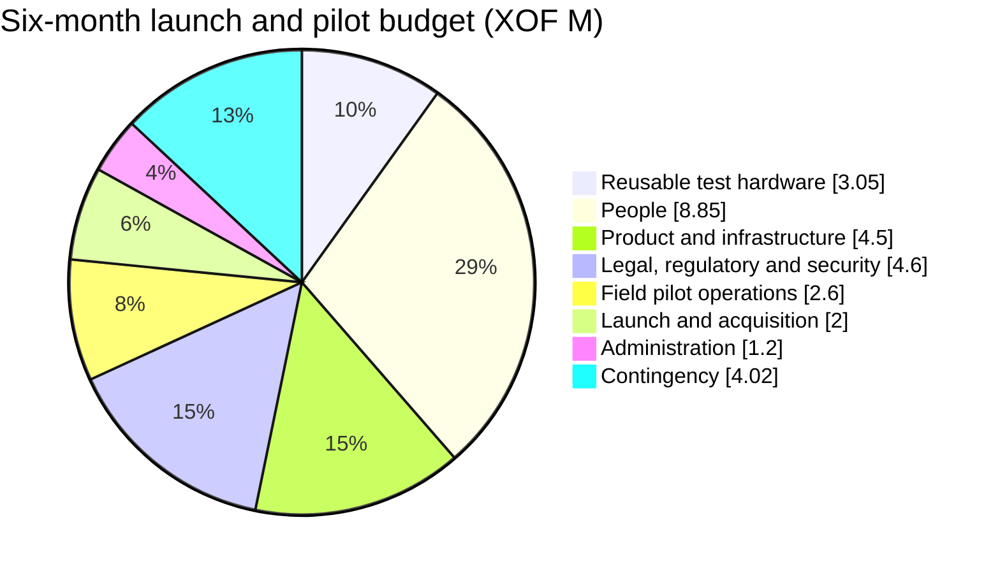

# Fidelia — Finance: pilot budget, forecast and evidence

*Working document · October 2026 · Côte d'Ivoire · XOF*

This is Fidelia's **only financial model**. The figures in the [investor brief](INVESTOR-BRIEF.md) come from it; when a number changes here, change it there too (and in its French version and the web pages it names).

Euro equivalents use the fixed peg **€1 = XOF 655.957** and are rounded to two decimals. XOF remains the operating and contracting currency; euro values are for comparison. **Every amount is a management estimate or an assumption to test, not a supplier quote or an observed result.**

## 1. Summary

| | Amount |
|---|---:|
| Six-month launch and pilot envelope (direct costs + 15% contingency) | **XOF 30,820,000 (€46,984.79)** |
| Pre-seed pilot round that funds it, in two tranches (§ 4) | **XOF 31M (€47,260)** |
| Total funding need to the end of year 3 ([§ 3](#3-three-year-forecast)) | **about XOF 148M**, in two rounds |
| Paying merchants needed to cover fixed costs | 334 (year 1) · 625 (year 2) · **1,250 (year 3, reached in Q11)** |

The pilot round funds the first six months only, including reusable test devices. Deferring both founder stipends would remove **XOF 6.0M (€9,146.94)** of direct costs and bring the envelope down to about **XOF 23.92M (€36,465.80)** after recalculating contingency. That is deferred compensation, not a zero-cost operating model.

## 2. Six-month pilot budget

### Scope and assumptions

- Six months: about two months for discovery, compliance, partner setup and production readiness (Phase 0), then four months of field operation (Phase 1), enough to observe at least 60 days of real use. One Abidjan corridor, no expansion.
- Five to ten maquis and grocery shops (pharmacies are out of the pilot, see [CONCEPT.md § 12](CONCEPT.md#12-pilot-boundaries)). **The pilot is free for every merchant**; at the end, each is offered the paid plan.
- Company-owned test devices only, no merchant hardware: two Android phones, two iPhones, two Android tablets, two iPads and two mid-range/refurbished laptops. Prices are allowances, not quotes; reduce them if suitable devices are already available.
- Production readiness includes Tier 0 phone/OTP login, access controls, production secrets/backups, one live payment-partner integration, and Wave capture if access is approved.
- Fidelia does not hold funds, lend, underwrite, or fund merchant rewards. Customer payments continue on the merchant's existing wallet; aggregator routing is not assumed as the default.
- Costs are shown gross in XOF. Tax treatment, VAT recoverability, company status, and any partner onboarding or minimum-volume fees require confirmation.

### Itemized budget

| Cost area | Basis | XOF | EUR equivalent |
|---|---|---:|---:|
| **Reusable test hardware** |  | **3,050,000** | **4,649.70** |
| Android phones | 2 × 125,000 | 250,000 | 381.12 |
| iOS phones (iPhones) | 2 × 300,000 | 600,000 | 914.69 |
| Android tablets | 2 × 150,000 | 300,000 | 457.35 |
| iOS tablets (iPads) | 2 × 300,000 | 600,000 | 914.69 |
| Laptops | 2 × 500,000; mid-range/refurbished estimate | 1,000,000 | 1,524.49 |
| Cases, chargers, adapters and screen protection | Fleet allowance | 300,000 | 457.35 |
| **People** |  | **8,850,000** | **13,491.74** |
| Technical founder stipend | 6 months × 600,000 | 3,600,000 | 5,488.16 |
| Commercial/partnership founder stipend | 6 months × 400,000 | 2,400,000 | 3,658.78 |
| Pilot coordinator / field officer | 6 months × 350,000 | 2,100,000 | 3,201.43 |
| Part-time customer support and data QA | 3 months × 250,000 | 750,000 | 1,143.37 |
| **Product and infrastructure** |  | **4,500,000** | **6,860.21** |
| Specialist integration and production hardening | 24 days × 100,000; OTP, Wave/webhook work, access control and release readiness | 2,400,000 | 3,658.78 |
| Hosting, database, domain, backups and monitoring | 6 months × 150,000 | 900,000 | 1,372.04 |
| OTP, SMS/WhatsApp and payment test costs | Pilot-volume allowance; confirm provider rates | 600,000 | 914.69 |
| Merchant connectivity allowance | 10 outlets × 10,000 × 6 months; no merchant phone purchase | 600,000 | 914.69 |
| **Legal, regulatory and security** |  | **4,600,000** | **7,012.65** |
| Company registration and brand/legal administration | One-time allowance; remove or reduce if already completed | 800,000 | 1,219.59 |
| Regulatory, privacy and commercial counsel | Funds-flow, data/consent review, terms and partner agreement | 1,800,000 | 2,744.08 |
| Independent scoped security assessment | Production-readiness review and retest allowance | 1,500,000 | 2,286.74 |
| Payment-partner contract and onboarding support | Excludes any unquoted partner minimums | 500,000 | 762.25 |
| **Field pilot operations** |  | **2,600,000** | **3,963.67** |
| Corridor transport and field per diem | 6 months × 250,000 | 1,500,000 | 2,286.74 |
| Merchant onboarding and training | 10 outlets × 50,000 | 500,000 | 762.25 |
| Printed QR / merchant materials | One-time corridor kit | 250,000 | 381.12 |
| Merchant association meetings and field sessions | Allowance | 350,000 | 533.57 |
| **Launch and acquisition** |  | **2,000,000** | **3,048.98** |
| French/local-language launch content and creative | Allowance; prioritize French and merchant-facing materials | 500,000 | 762.25 |
| Corridor launch and customer activation | Local, targeted activity; no broad paid-media campaign | 800,000 | 1,219.59 |
| Referral / reseller commissions | Capped pilot allowance; pay only on eligible acquired merchants | 300,000 | 457.35 |
| Partner demos and outreach | Allowance | 400,000 | 609.80 |
| **Administration** |  | **1,200,000** | **1,829.39** |
| Bookkeeping and accounting | 6 months × 100,000 | 600,000 | 914.69 |
| Business communications, bank and administrative charges | Allowance | 300,000 | 457.35 |
| Essential software and productivity tools | Allowance | 300,000 | 457.35 |
| **Direct-cost subtotal** |  | **26,800,000** | **40,856.34** |
| Contingency | 15% of direct costs | 4,020,000 | 6,128.45 |
| **Total** |  | **30,820,000** | **46,984.79** |

### What the budget does not include

- A second operator integration, PI-SPI connection, or work beyond the single-partner MVP.
- Phase 2 campaigns at scale, multi-outlet sales, tontines, scoring, savings, lending, or financial-partner commissions.
- Loan principal, customer funds, merchant payment volume, or merchant-funded rewards.
- Hardware beyond the reusable test fleet (merchant phones, POS terminals); the concept and market review caution against hardware-heavy deployment.
- Full-market salaries, founder back pay, geographic expansion, or more than six months of runway.
- Unquoted partner setup/minimum fees, major incident response, litigation, or taxes not covered by the allowances.

Any material payment-provider charge must be disclosed before the customer pays and must not make a merchant's payment more expensive than its existing wallet.

### Pilot revenue

**Zero by design**: subscriptions and offers are free during the pilot, and the funding requirement is gross spend. For scale only, if all 5–10 pilot merchants accepted the paid plan, the first four months after the pilot would bring **XOF 100,000 (€152.45) to XOF 600,000 (€914.69) gross**. This is an illustration, not a forecast.

## 3. Three-year forecast

With 1,800 paying merchants at the end of year 3, Fidelia earns about **XOF 14 million a month** and covers its fixed costs; it needs about **XOF 148 million in total** to get there, in two rounds. Every number is an assumption to replace with pilot results.

Paying merchants at each quarter end, from the pilot start: Q1 0 · Q2 4 · Q3 40 · Q4 100 · Q5 180 · Q6 280 · Q7 420 · Q8 600 · Q9 800 · Q10 1,050 · Q11 1,400 · Q12 1,800. Fixed costs are covered from 334 paying merchants in year 1 (after the pilot), 625 in year 2 and **1,250 in year 3, reached in Q11**. Losses still grow in year 3 because acquisition spending grows with the merchant base.

| XOF millions | Year 1 | Year 2 | Year 3 |
|---|---:|---:|---:|
| Paying merchants at year end | 100 | 600 | 1,800 |
| Revenue | 2.1 | 29.2 | 105.5 |
| Fixed costs (year 1 includes the 30.8 pilot) | 42.8 | 48.0 | 96.0 |
| Acquisition | 4.0 | 20.0 | 48.0 |
| Variable costs | 0.4 | 5.5 | 20.0 |
| **Net result** | **−45.1** | **−44.4** | **−58.6** |
| Cumulative funding need | 45.1 | 89.5 | 148.1 |

| Assumption | Value | Basis |
|---|---|---|
| Subscription | 7,500 F / month / outlet, blended | Mid-point of the 5,000 F and 10,000–15,000 F plans ([BUSINESS-MODEL.md](BUSINESS-MODEL.md#pricing-experiment)) |
| Sponsored deals, from year 2 | 10% of merchants buy 2 placements a month at 2,000 F (+400 F per merchant) | Placement prices tested at 1,000–3,000 F per 7 days ([BUSINESS-MODEL.md](BUSINESS-MODEL.md)) |
| Pilot conversion | 4 of 10 pilot merchants pay at month 6 | The pilot's ≥ 40% exit gate |
| Growth | 100, 600 and 1,800 paying merchants at year ends, net of churn | One commune, then more Abidjan communes; to rebuild from the pilot's real acquisition rate |
| Acquisition cost | 40,000 F per new paying merchant | Field agents and reseller commissions; the pilot budgets 50,000 F per onboarding |
| Variable cost | 1,500 F / month / merchant (80% margin at 7,500 F) | Hosting, SMS codes, support |
| Fixed costs | Pilot 30.8M, then 2M / month (year 1), 4M (year 2), 8M (year 3) | § 2, then a field team and support that grow with merchants |
| Partner commissions | 0 | Not assumed until a partner agreement exists |

The post-pilot XOF 2.0M/month of year 1 comprises founder stipends (XOF 1.0M), field and customer support (XOF 500,000), fixed hosting/backups (XOF 150,000), sales and travel (XOF 200,000), and bookkeeping, administration and software (XOF 150,000).

Break-even formula: monthly fixed costs ÷ (revenue per merchant − variable cost per merchant), rounded up. Year 1: 2,000,000 ÷ 6,000 = 334. Years 2–3 add the sponsored-deal 400 F: 4,000,000 ÷ 6,400 = 625 and 8,000,000 ÷ 6,400 = 1,250.

**Funding path:** this pilot round (XOF 31M), then a seed round of about XOF 120M (€180k) once the pilot gate is met. A grant (APIF-CI, AfDB, develoPPP; see [PARTNERS.md](PARTNERS.md#funders-for-fidelia)) lowers both.

## 4. Release and control of funds

The pilot round is released in two tranches, each tied to a gate, so no money is spent ahead of evidence.

| Tranche | Funds | Released when | Spend controls |
|---|---|---|---|
| **1 · Phase 0** (months 1–2) | XOF 14M (€21,340) | At signing | Regulatory and data-protection review, production readiness (phone login, Wave capture, security review), test devices. Do not expose real users or money while authentication, authorisation, backups, reconciliation and the funds-flow review remain unresolved |
| **2 · Phase 1** (months 3–6) | XOF 17M (€25,920) | At the Phase 0 exit gate: licensed payment partner confirmed, Wave has answered on API access, 5–10 merchants have signed the pilot agreement, no open critical issue in the production-readiness review | Release field and customer-activation spend only after written partner and merchant arrangements are in place |
| **Continuation review** | — | After 60+ days of use | Review recorded share of real sales, merchant activity, new customers brought by the customer app, repeat visits, day-45 commitments and the share of merchants accepting the paid plan, support and messaging cost, and any unresolved privacy, security or regulatory issue, before extending the pilot or raising the seed round |

Track actuals monthly by category. Obtain at least two local quotes for legal/security, messaging and field services; reconcile merchant acquisition and subscription receipts separately. Keep the contingency under founder approval; it is not a spend target.

## 5. Evidence to collect

Use these registers to replace assumptions with supplier quotes, receipts and observed results. **No supplier quote or commercial result is verified yet.** Do not present blank fields as commitments or evidence.

### Supplier quotes

Collect two comparable quotes where possible. For each, record: supplier legal name and contact · quote date and validity · currency · price before and including tax · delivery/installation fees · payment schedule and method · warranty and maintenance · cancellation terms · approver · location of the supporting document. Add omitted costs to the budget and recalculate the 15% contingency.

| Item to quote | Budget allowance | Quote 1: supplier / price | Quote 2: supplier / price | Status / supporting document |
|---|---:|---|---|---|
| Test fleet: phones, tablets, laptops, and accessories | XOF 3,050,000 | To collect | To collect | Unverified |
| Specialist integration and production hardening | XOF 2,400,000 | To collect | To collect | Unverified |
| Hosting, domain, backups, and monitoring | XOF 900,000 for 6 months | To collect | To collect | Unverified |
| OTP, SMS/WhatsApp, and payment tests | XOF 600,000 | To collect | To collect | Confirm unit rates and monthly minimums |
| Company and brand registration | XOF 800,000 | To collect | To collect | Reduce if already paid |
| Legal, data-protection, and regulatory counsel | XOF 1,800,000 | To collect | To collect | Unverified |
| Independent security audit | XOF 1,500,000 | To collect | To collect | Confirm scope and retest |
| Payment-partner contract and integration | XOF 500,000 | To collect | To collect | Partner minimum fees excluded until quoted |
| Transport, field work, and pilot support | XOF 2,600,000 | To collect | To collect | Confirm days and trips |
| Launch materials and acquisition | XOF 2,000,000 | To collect | To collect | Separate one-off spend from cost per merchant |
| Accounting, banking, communications, and software | XOF 1,200,000 | To collect | To collect | Unverified |

### Merchant growth

The growth path in § 3 (100, 600, 1,800 paying merchants at year ends) is **unverified** and ambitious relative to a 5–10-merchant pilot. Do not present it as a commitment.

| Assumption | Evidence to collect | Calculation or check | Status |
|---|---|---|---|
| 5–10 outlets can join the pilot | Named outlet list, segment/corridor, written agreement, onboarding date | Count outlets that are genuinely active, separately from leads | To confirm |
| Merchants will pay 5,000–15,000 F/month | Accepted price, first invoice and receipt per outlet | Paid conversion = merchants who paid ÷ eligible active merchants | Unverified |
| Merchants renew | Receipts and invoices across consecutive months; cancellation reasons | Renewal and cancellation at 30/60/90 days | Unverified |
| Acquisition at the § 3 pace, at 40,000 F each | Monthly log of leads, demos, sign-ups, first payments, cancellations, channel and cost | New paying merchants less cancellations; cost per new paying merchant | Unverified |
| Growth repeats beyond the first cohort | Results by corridor, segment and channel | At least three consecutive months of observed results before using the rate in the base case | Unverified |

For every merchant, record contact date, referral source, acquisition cost, activation date, price actually paid, renewal dates, sales recorded, and reason for leaving. A free trial, unpaid registration or letter of interest does not count as a paying merchant.

### Price and margin

| Assumption | Records and data needed | Check formula | Status |
|---|---|---|---|
| Average price collected: 7,500 F/month | Tested price list, invoices, receipts, discounts, days overdue | Subscription cash collected ÷ paying merchants | Untested |
| Sponsored-deal demand and price | Bookings of 7-day slots at 1,000/2,000/3,000 F; invoices and receipts; delivery record; direct costs | Placements booked **and paid** per month; cash received less direct delivery cost | Untested |
| Variable cost: 1,500 F/month/merchant | OTP/SMS/WhatsApp invoices, variable cloud costs, payment fees paid by Fidelia, variable commissions, support time | Directly attributable variable costs ÷ paying merchants | Unverified |
| Notification cost is affordable | Local channel quotes and invoices; messages per outlet | Notification spend ÷ active outlets | To measure in pilot |
| Fixed costs stay at 2M/month after the pilot (year 1) | Monthly contracts and invoices for team, hosting, accounting, travel, tools | Recurring fixed costs, separate from variable costs | To confirm |

Do not count payment or lender commissions without a signed contract, confirmed receipt, valid consent and regulatory clearance. Money paid directly from a customer's wallet to a merchant is never Fidelia revenue.

| Month / cohort | Active paying merchants | Subscription cash received (XOF) | Notifications and other variable costs (XOF) | Margin after variable costs | Data source |
|---|---:|---:|---:|---:|---|
| To complete | To complete | To complete | To complete | To calculate | Invoices + receipt register |

Margin after variable costs = (subscription cash received − variable costs) ÷ subscription cash received. Track monthly and by cohort; never substitute the assumption for missing data.

## 6. Before sharing with a funder

1. Replace significant supplier allowances with dated, comparable, archived quotes; recalculate the total, VAT and contingency.
2. Update the forecast with actual payment dates, cash receipts and bridge funding needed; state whether the funding is a grant, equity, loan or another instrument.
3. Attach anonymised pilot invoices and receipts, acquisition and renewal records, messaging quotes and the monthly margin record.
4. Separate observed facts, supplier quotes, assumptions and targets. Keep every unverified item labelled.

## Related documents

[INVESTOR-BRIEF.md](INVESTOR-BRIEF.md) · [INVESTOR-READINESS.md](INVESTOR-READINESS.md) · [BUSINESS-MODEL.md](BUSINESS-MODEL.md) · [ROADMAP.md](ROADMAP.md) · [PARTNERS.md](PARTNERS.md)
